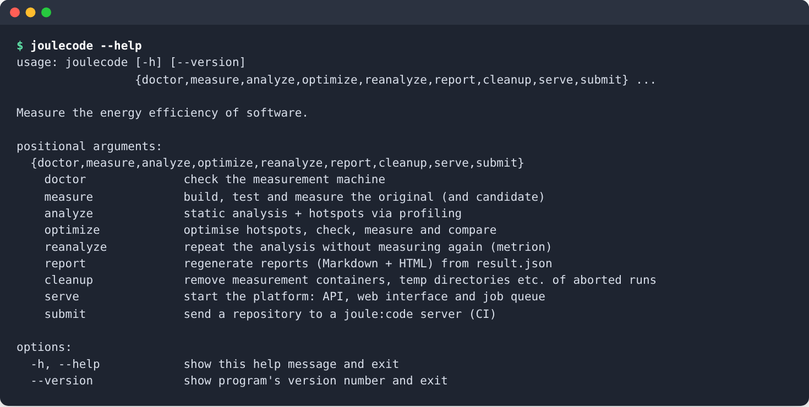
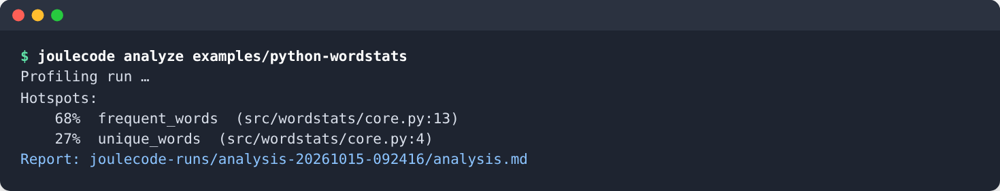
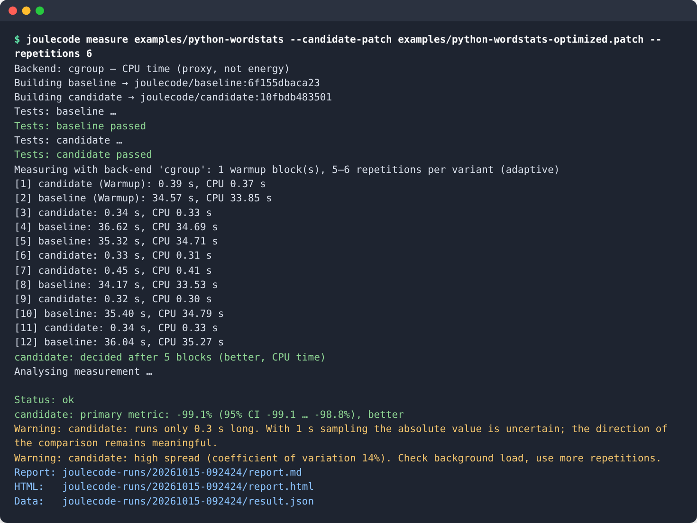
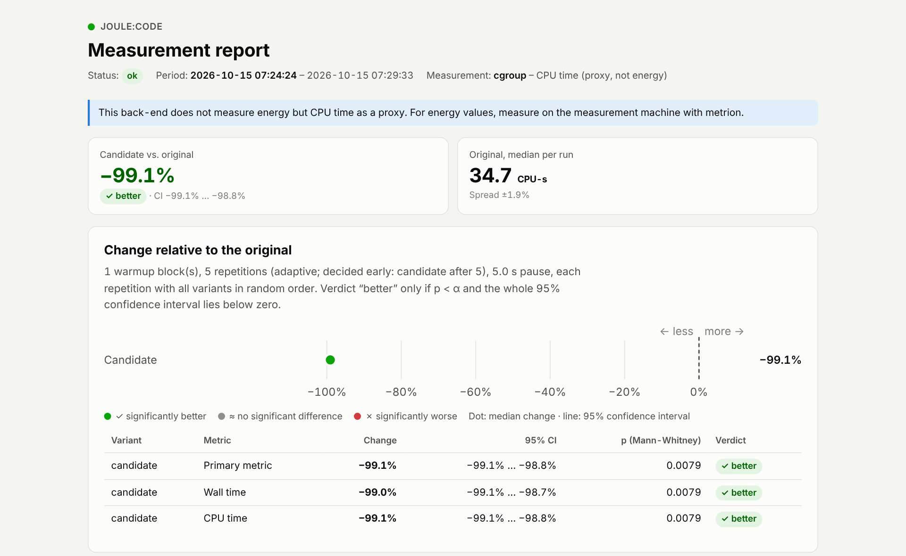

<p align="center">
  <picture>
    <source media="(prefers-color-scheme: dark)" srcset="img/joulcode_logo_label_dark.png">
    
  </picture>
</p>

<p align="center"><b>Make software more energy-efficient — and prove it with measurements.</b></p>

joule:code finds the functions where your program spends its energy, lets a local LLM
propose faster versions, and accepts a change only if it passes the original test suite
**and** uses significantly less energy in repeated, interleaved measurements. Static
analysis and the LLM only make suggestions; the measurement decides.

```
your repo ──▶ profile ──▶ hotspots ──▶ LLM candidates ──▶ tests ──▶ maintainability review
 (Docker +                                                 (must      (rules + LLM veto)
 joulecode.yml)                                             pass)            │
                    report.html ◀── Pareto: energy vs. ◀── measure original vs. candidates
                    + patches       maintainability        (fresh container per run, CI 95 %)
```

- **Measured, not estimated.** Energy per container via [METRION](https://github.com/ds-lab/Metrion)
  (eBPF + RAPL), whole-socket RAPL, or CPU time as a fallback. The report always says which.
- **Tests are a hard gate.** Tests, benchmark and config are protected paths a candidate cannot touch.
- **Sound statistics.** Randomised interleaved blocks, bootstrap 95 % confidence interval,
  Mann–Whitney U, adaptive stopping with Bonferroni correction, plausibility checks.
- **Python, PHP, JavaScript/TypeScript and Java.** Language tools run in their own Docker images.
- **Fully local.** Ollama runs the LLM on your machine; nothing leaves it.
- **CI integration.** A small self-hosted server (think: a local SonarQube for energy) with
  quick reviews, energy regression gates for pull requests and SARIF output.

joule:code is developed at the Institute for Digitalization Aachen (FH Aachen University of
Applied Sciences) within the international ITEA 4 project **GreenCode**
([project page](https://itea4.org/project/greencode.html) · [greencode.ai](https://greencode.ai/)),
which also produced the energy measurement tool [METRION](https://github.com/ds-lab/Metrion).

> **Status:** research prototype (v0.2, pre-release). The measurement chain, the optimisation
> pipeline, all four language back-ends and the platform are implemented and tested;
> interfaces may still change.

## Security notice

> [!WARNING]
> joule:code **executes the code it analyses** — the tests and the benchmark of your repository
> and every candidate the LLM writes. All of this runs in isolated Docker containers without
> network, but access to Docker is equivalent to root access on the machine.
>
> - Only use joule:code on repositories **you trust** as much as you would trust running their
>   test suite yourself.
> - Run it on a **dedicated machine** (the measuring host), not on a workstation with sensitive data.
> - On the platform, anyone with a project token can run code on the server: accept jobs only from
>   trusted branches, never from forks.
>
> Details and how to report vulnerabilities: [SECURITY.md](SECURITY.md).

## Contents

1. [Ways to use joule:code](#ways-to-use-joulecode)
2. [Requirements](#requirements)
3. [Installation](#installation)
4. [Setup and configuration](#setup-and-configuration)
5. [Usage](#usage) — [doctor](#check-the-machine-joulecode-doctor) ·
   [analyze](#find-hotspots-joulecode-analyze) · [measure](#measure-a-change-joulecode-measure) ·
   [optimize](#let-the-llm-optimise-joulecode-optimize) · [platform and CI](#platform-and-ci-joulecode-serve-and-joulecode-submit) ·
   [test suite](#check-joulecode-itself-test-suite) · [housekeeping](#housekeeping)
6. [Further documentation](#further-documentation)
7. [Contributing, citation, license](#contributing)

## Ways to use joule:code

| I want to … | Command | Takes |
|---|---|---|
| see where my code spends its time and which known inefficiencies it contains | `joulecode analyze` | seconds–minutes |
| know whether a change saves energy | `joulecode measure` | minutes |
| get optimised, tested and measured candidates | `joulecode optimize` | 30 min – hours |
| get hints on every pull request and block energy regressions | `joulecode serve` + `joulecode submit` in CI | seconds (review) / minutes (gate) |
| check how well joule:code judges known cases | `scripts/suite.py` | hours |

Each of them is explained step by step under [Usage](#usage).

## Requirements

The recommended set-up is a dedicated **measuring host**; all alternatives work with the
limitations stated.

| | Recommended | Alternative |
|---|---|---|
| Machine | **Ubuntu 24.04 / 26.04 on bare metal** (no VM, no WSL), used only for measuring | any Linux or Windows with WSL 2 |
| CPU | **Intel** with RAPL energy counters → real energy via **METRION** | any CPU → CPU time instead of energy (`cgroup` back-end) |
| GPU | **NVIDIA, ≥ 12 GB VRAM** for the language model | smaller GPU or none (slower) |
| RAM / disk | 32 GB / 50 GB free | 16 GB / 20 GB |
| Software | installed by `scripts/install.sh` | Docker, Python ≥ 3.11, Git |

**Language model.** The optimiser runs Qwen2.5-Coder locally with Ollama. Choose the largest
model that fits into your GPU memory:

| GPU memory | Model | Download | |
|---|---|---|---|
| **≥ 12 GB** | **`qwen2.5-coder:14b`** | 9 GB | **recommended default**, good for all four languages |
| ≥ 24 GB | `qwen2.5-coder:32b` | 20 GB | strongest candidates (not yet evaluated with the test suite) |
| 8 GB | `qwen2.5-coder:14b` (partly on the CPU) or `qwen2.5-coder:7b` | 9 / 4.7 GB | 14B slower but better; 7B fine for Python, weak for PHP/JS/Java |
| none | `qwen2.5-coder:7b` on the CPU | 4.7 GB | works, but generating candidates takes much longer |

`joulecode analyze` and `joulecode measure` need no language model at all. Details:
[installation guide, requirements](docs/installation.md#1-before-you-start-requirements).

## Installation

On a measuring host, one script installs everything — system packages, Docker, NVIDIA driver and
container toolkit, METRION as an on-demand service, joule:code, the settings file
`.joulecode.env` and Ollama with the model — and can safely be re-run:

```bash
git clone https://github.com/fhac-ida/joulecode.git ~/joulecode && cd ~/joulecode
./scripts/install.sh                     # see ./scripts/install.sh --help for all options
# reboot if asked, run the script again, log in again, then:
source .venv/bin/activate && joulecode doctor
```

**→ Follow the complete step-by-step guide: [docs/installation.md](docs/installation.md).** It
covers choosing the model, METRION ≥ 0.2, the first measurement, noise reduction, and the
alternatives: without an NVIDIA GPU, without METRION (`rapl`), and on any Linux/WSL machine with
Docker (`cgroup`, CPU time instead of energy).

## Setup and configuration

joule:code is configured in two places:

1. **`.joulecode.env`** (in the joule:code folder) holds the settings of *your machine*: energy
   back-end, language model, METRION paths and, if you use the platform, server and token. The
   install script creates it; `source .venv/bin/activate` loads it. Because of this file, the
   commands below need no options — every option is only an override for a single run.

   ```bash
   # excerpt from .joulecode.env
   export JOULECODE_OLLAMA_MODEL="qwen2.5-coder:14b"
   # export JOULECODE_BACKEND="auto"         # "cgroup" on a machine without energy counters
   # export JOULECODE_SERVER="http://measuring-host:8765"
   ```

2. **`Dockerfile` + `joulecode.yml`** (in *your* repository) say how to build, test and benchmark
   your code. Containers run without network, so the Dockerfile installs all dependencies. The
   benchmark is yours to write: joule:code optimises towards it, so it should represent real use
   and run at least ~20 s.

   ```yaml
   version: 1
   language: python                     # python | php | javascript | typescript | java
   test:
     command: pytest -q
   benchmark:
     command: python bench/run.py       # fixed, deterministic workload
   protected_paths: [tests, bench, joulecode.yml]   # candidates cannot change these
   ```

**→ Step-by-step guide and all keys: [docs/configuration.md](docs/configuration.md).**
Copy a starting point for your language from [examples/](examples/README.md); language-specific
set-up (Composer, npm, Maven/Gradle, profilers) is in [docs/languages.md](docs/languages.md).

## Usage

The typical path for a repository goes from cheap to expensive:

1. `joulecode doctor` — is the machine ready, which back-end measures?
2. `joulecode analyze` — where is the time spent, which known inefficiencies are there?
3. `joulecode measure` — does a change (yours or someone else's) really save energy?
4. `joulecode optimize` — let the LLM propose, test and measure optimisations.
5. `joulecode serve` / `submit` — do 2. and 3. automatically for every pull request.

> [!TIP]
> **Every command explains itself:** `joulecode --help` lists all commands,
> `joulecode <command> --help` shows all options of one command with their defaults. The full
> reference is in [docs/cli.md](docs/cli.md).

<p align="center"></p>

All examples below use the example project [examples/python-wordstats](examples/python-wordstats)
and run in the joule:code folder after `source .venv/bin/activate`. Replace the path with your
own repository. Results go to `joulecode-runs/<timestamp>/` (option `--out` to change).

### Check the machine: `joulecode doctor`

```bash
joulecode doctor
```

Checks operating system, cgroups, Docker, GPU, RAPL and every energy back-end, and prints the
most accurate back-end that is ready. Run it after the installation and whenever measurements
look odd. Exit code 1 if a required check fails.

### Find hotspots: `joulecode analyze`

```bash
joulecode analyze examples/python-wordstats
```

Runs the static analysis tools of the language (Ruff/radon/vulture, PHPMD/Rector, ESLint, PMD)
on the whole repository and profiles the benchmark in its container. Prints the **hotspots** —
the functions with the largest share of run time — and writes `analysis.md` and
`analysis.json`. Takes seconds to minutes and needs no language model; ideal for a first look.

<p align="center"></p>

Useful options: `--hotspots N` (how many), `--no-profile` (static analysis only, without Docker).

### Measure a change: `joulecode measure`

```bash
# a change as a patch (e.g. from git diff) against the current state
joulecode measure examples/python-wordstats --candidate-patch examples/python-wordstats-optimized.patch

# or: a second folder as the candidate, e.g. your working tree against the branch main
joulecode measure path/to/repo --baseline-ref main --candidate-dir path/to/repo

# noise check: the original against itself (A/A) – should show no difference
joulecode measure examples/python-wordstats --aa
```

joule:code builds both variants, runs the tests in each (both must pass), measures the benchmark
in randomised, interleaved blocks — each run in a fresh container — and stops as soon as the
verdict is statistically settled. The console shows every run:

<p align="center"></p>

The result folder contains `report.html` (open it in a browser), `report.md` and `result.json`.
The report shows the change with its 95 % confidence interval, the verdict (**better**, **worse**
or **no significant difference**), every single run and warnings such as high spread:

<p align="center"></p>

*(These screenshots come from a machine without energy counters, so they show CPU time; on a
measuring host the same report shows energy in joules, measured by METRION.)*

Useful options: `--repetitions N` / `--min-repetitions N` / `--fixed` (how long to measure),
`--env BENCH_ROUNDS=80` (benchmark load), `--backend NAME` (override `.joulecode.env`).

### Let the LLM optimise: `joulecode optimize`

```bash
joulecode optimize examples/python-wordstats
```

The full pipeline: build and test the original → profile → for each hotspot, the LLM writes
candidates → each candidate is inserted, tested (failing ones get a repair attempt), documented
and reviewed for maintainability → the model is unloaded → all admitted candidates are measured
against the original → the best candidates per hotspot are combined and measured again.

The result folder contains `report.html` with a table of all candidates (energy change with
confidence interval, verdict, maintainability score, Pareto front of energy vs. maintainability)
and, per candidate, a Markdown report and a `.patch`. **Nothing is applied automatically** — you
review the patch and apply it with `git apply`.

Useful options: `--no-measure` (only generate and test candidates — a quick trial run),
`--hotspots N` / `--candidates N` (how much to try), `--model NAME` (override `.joulecode.env`).
How the agents work: [docs/architecture.md](docs/architecture.md#agents).

### Platform and CI: `joulecode serve` and `joulecode submit`

`joulecode serve` runs a small web application on the measuring host. CI jobs or developers
upload their working tree with `joulecode submit` and get the result back — the measurement
always runs on the measuring host, so any CI runner can use it.

| Mode | Takes | Result |
|---|---|---|
| `review` | seconds | findings of the analysis tools for the **changed functions**, with fix suggestions, as text and SARIF |
| `gate` | minutes | energy change of the pull request against the target branch (95 % CI), tests on both sides, pass/fail |
| `optimize` | hours | measured candidates and patches, as with `joulecode optimize` |

**1. Start the server** (on the measuring host):

```bash
pip install -e '.[server]'
joulecode serve                     # prints where to find the admin token on first start
```

**2. Create a project:** open `http://localhost:8765`, choose **Access**, paste the admin token,
then **New project**. Copy the project token that is shown once.

<p align="center"></p>

**3. Submit.** Put server, project and token into `.joulecode.env` (or the CI secrets), then:

```bash
joulecode submit --base origin/main --fail-on major          # review of the changed functions
joulecode submit --mode gate --base origin/main              # energy gate: fail if > 5 % worse
```

<p align="center"></p>

Every job has a page with its progress, the quality gate, findings or measurement and its log:

<p align="center"></p>

Exit codes: `0` passed (or no condition set), `1` gate failed, `2` error. The project page shows
ready-to-copy **GitHub Actions** and **GitLab CI** templates (*Setup & token*). Setup, all modes,
CI templates, SARIF and the security model: **[docs/platform.md](docs/platform.md)**.

### Check joule:code itself: test suite

Twelve example projects with known expectations check that joule:code **judges correctly**, not
just that it runs: positive cases, traps for behaviour-changing optimisations, a negative
control, a case without hotspots, and one long example (1,150–1,450 lines) per language. Hidden
holdout tests reveal gaps in the test gate; reference patches show what is achievable.

```bash
python scripts/suite.py check                       # validate examples, calibrate benchmarks
python scripts/suite.py run --repeat 3 --reference  # all examples, e.g. overnight
```

All examples, expectations and how to read the results:
[examples/suite/README.md](examples/suite/README.md).

### Housekeeping

| Command | When |
|---|---|
| `joulecode report DIR` | re-create `report.md` / `report.html` from a `result.json` |
| `joulecode reanalyze DIR` | evaluate archived METRION data again without measuring (e.g. after a failed evaluation) |
| `joulecode cleanup` | remove containers, temporary folders and a running METRION service left over by aborted runs (`--dry-run` first, `--images`, `--runs-older-than DAYS`) |

Only one measurement runs at a time on a machine: `measure`, `analyze` and `optimize` take a lock,
and the platform waits for it.

## Further documentation

| Document | What you find there beyond this README |
|---|---|
| [docs/installation.md](docs/installation.md) | the complete step-by-step installation, model choice per GPU, alternatives (no GPU, `rapl`, `cgroup`), what the install script does in each step, how joule:code drives METRION, manual installation, noise reduction, updating and uninstalling |
| [docs/configuration.md](docs/configuration.md) | setting up `.joulecode.env` and a repository step by step, writing a good benchmark, every key of `joulecode.yml` with defaults, all environment variables |
| [docs/cli.md](docs/cli.md) | every command and option (the same as `--help`, in one place), output folders, helper scripts |
| [docs/languages.md](docs/languages.md) | Python, PHP, JavaScript/TypeScript, Java: Dockerfile templates, profilers, how each language back-end finds and replaces functions, adding a language |
| [docs/platform.md](docs/platform.md) | server set-up, `--processor` modes, `submit` options, complete GitHub Actions and GitLab CI templates, how review/gate/optimize work, quality gate, SARIF, result schema, storage, security |
| [docs/architecture.md](docs/architecture.md) | design principles, measurement protocol and statistics, energy back-ends, hotspot detection, the LLM agents, why LLM and measurement never run together |
| [examples/README.md](examples/README.md) | the example projects for every language and their structure, as templates for your own |
| [examples/suite/README.md](examples/suite/README.md) | the test suite: examples with expectations, holdout tests, reference patches, how to run and read it, adding an example |
| [deploy/metrion/README.md](deploy/metrion/README.md) | the METRION service and configuration files used by the install script |
| [SECURITY.md](SECURITY.md) | security model and how to report vulnerabilities |
| [CONTRIBUTING.md](CONTRIBUTING.md) | development set-up, tests, language tools without Docker, conventions |
| [CHANGELOG.md](CHANGELOG.md) | what changed in each version |

## Contributing

Bug reports, ideas and pull requests are welcome — see [CONTRIBUTING.md](CONTRIBUTING.md) for
the development setup. Please report security issues privately as described in
[SECURITY.md](SECURITY.md).

## Citation

If you use joule:code in research, please cite it — see [CITATION.cff](CITATION.cff) (GitHub
shows a “Cite this repository” button).

## Acknowledgements

joule:code was developed at the Institute for Digitalization Aachen (FH Aachen University of
Applied Sciences) within the ITEA 4 project **GreenCode**
([itea4.org/project/greencode](https://itea4.org/project/greencode.html),
[greencode.ai](https://greencode.ai/)). Energy measurement builds on
[METRION](https://github.com/ds-lab/Metrion), developed in the same project, which is installed
separately and has its own license.

## License

[MIT](LICENSE) © Institute for Digitalization Aachen | FH Aachen University of Applied Sciences | Project GreenCode
