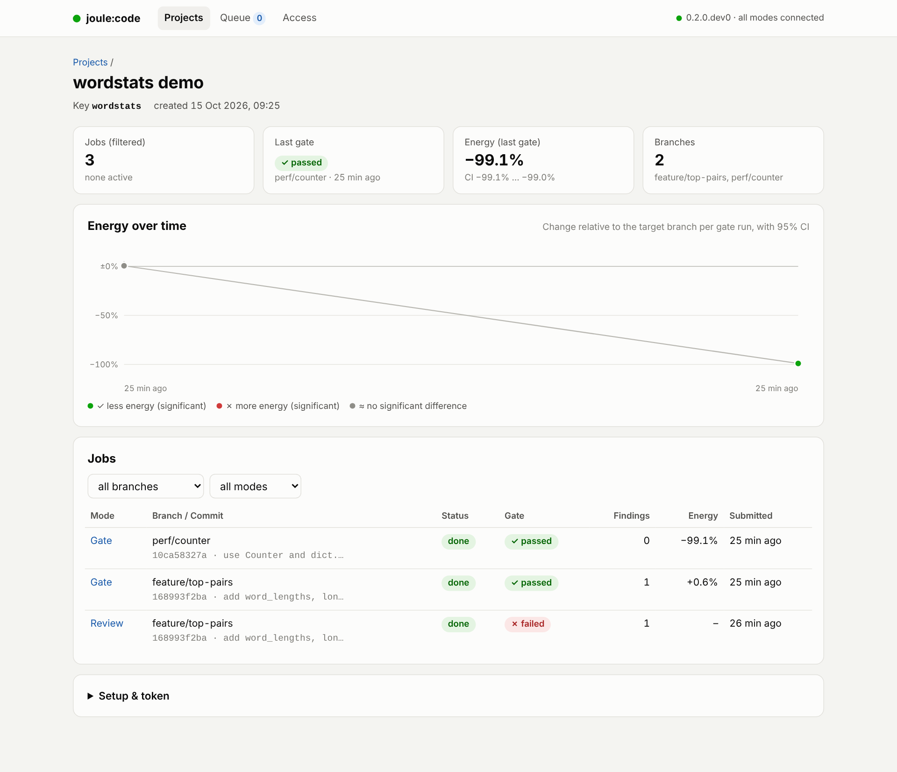
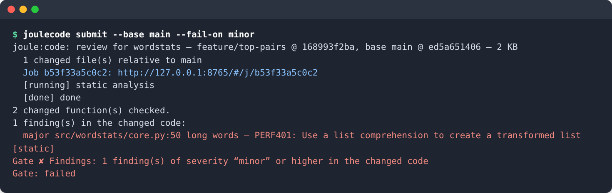
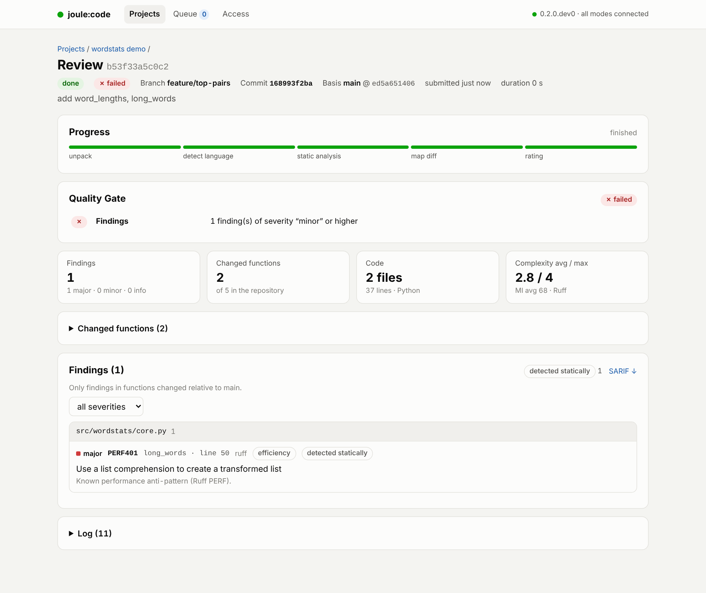
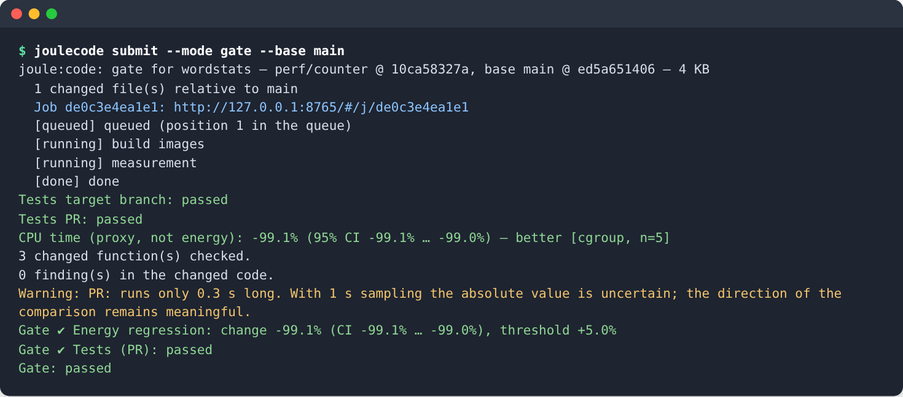
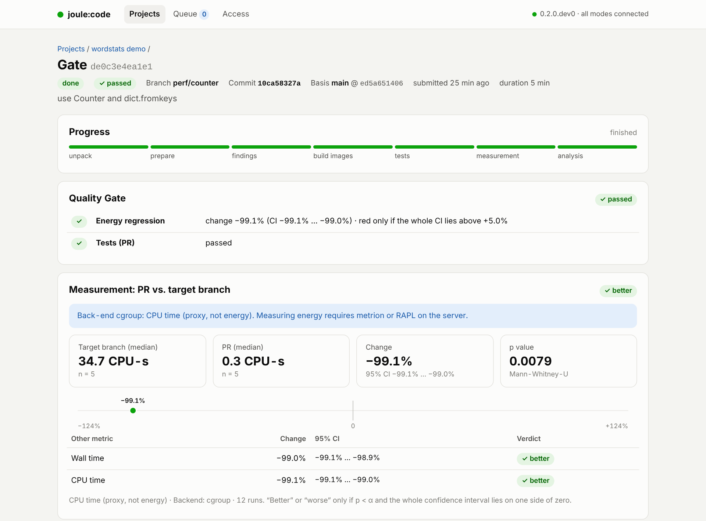

# Platform and CI

`joulecode serve` is a small self-hosted server — comparable to a local SonarQube instance,
but for energy. CI jobs or developers upload their working tree with `joulecode submit` and
get results back; measurements run on the server, so any CI runner can use it.

```
CI / developer                        measuring host
joulecode submit ──tar.gz──▶ joulecode serve ─┬─ REST API (FastAPI, /api/docs)
  ◀── status, result ───────                  ├─ SQLite: projects, jobs, logs
                                              ├─ queue + exactly ONE worker
                                              │    └─ processor (review | gate | optimize)
                                              └─ web UI (/)
```

## Modes

| Mode | Takes | Purpose | Result |
|---|---|---|---|
| `review` | seconds | quick hints without measuring | findings of the analysis tools for the changed functions, fix suggestions, SARIF |
| `gate` | minutes | energy regression: target branch (merge base) vs. PR head | energy change with 95 % CI, tests of both sides, pass/fail, full measurement report |
| `optimize` | hours | full pipeline | measured candidates with maintainability score and patches |

## Setting up

```bash
pip install -e '.[server]'          # FastAPI, uvicorn; `submit` alone needs neither
joulecode serve
```

On first start `serve` prints an **admin token** (also stored in
`~/.joulecode/server/admin-token`, or set `$JOULECODE_ADMIN_TOKEN`). Then:

1. Open `http://localhost:8765`, choose **Access** and paste the admin token.
2. Create a project with **New project** (a key such as `myapp`). You get a **project
   token** (`gcp_…`) — shown only once; store it as the CI secret `JOULECODE_TOKEN`.
3. **Setup** on the project page shows templates for local use, GitHub Actions
   and GitLab CI, already filled in with the server address and project key.

`serve --processor` decides what is real:

| `--processor` | review | gate / optimize | for |
|---|---|---|---|
| `full` (default) | real | real | the measuring host |
| `review` | real | simulated | a machine without measurement setup |
| `dummy` | simulated | simulated | trying out the UI and CI wiring |

Simulated results are marked `"dummy": true`, and the UI and `submit` say so clearly. At
start-up `serve` checks whether the energy back-end and the LLM are ready (informational).



## Submitting

On a developer machine, put the connection into [`.joulecode.env`](configuration.md#server-and-client-only-for-the-platform)
once (in CI, use the CI variables and secrets, see below):

```bash
export JOULECODE_SERVER="http://measuring-host:8765"
export JOULECODE_PROJECT="myapp"
export JOULECODE_TOKEN="gcp_…"
```

Then `joulecode submit` needs no connection options (`--server`, `--project`, `--token` override
them; see `joulecode submit --help`):

```bash

joulecode submit                                      # review of the whole repository
joulecode submit --base origin/main --fail-on major   # only changed functions, fail on "major"
joulecode submit --base origin/main --sarif gc.sarif  # findings for GitHub code scanning
joulecode submit --mode gate --base origin/main       # energy: PR vs. target branch, fail above +5 %
joulecode submit --mode optimize --no-wait            # generate and measure candidates (takes hours)
```



Exit code: `0` passed or no condition set, `1` gate failed, `2` error. In CI the job needs the
full history (`fetch-depth: 0` / `GIT_DEPTH: 0`), otherwise there is no merge base. Branch,
commit and target branch are taken from Git or from the GitHub Actions / GitLab CI variables
(`GITHUB_BASE_REF`, `CI_MERGE_REQUEST_TARGET_BRANCH_NAME` …).

### GitHub Actions

joule:code is not on PyPI; install it from the repository. The runner only needs to reach the
server — a server inside your network is usually only reachable from a self-hosted runner.

```yaml
# .github/workflows/joulecode.yml
name: joule:code
on: [pull_request]
jobs:
  review:
    runs-on: ubuntu-latest
    permissions: { contents: read, security-events: write }
    steps:
      - uses: actions/checkout@v4
        with: { fetch-depth: 0 }
      - run: pip install "joulecode @ git+https://github.com/fhac-ida/joulecode.git"
      - run: joulecode submit --fail-on major --sarif joulecode.sarif
        env:
          JOULECODE_SERVER: https://joulecode.example.org
          JOULECODE_PROJECT: myapp
          JOULECODE_TOKEN: ${{ secrets.JOULECODE_TOKEN }}
      - uses: github/codeql-action/upload-sarif@v3
        if: always() && hashFiles('joulecode.sarif') != ''
        with: { sarif_file: joulecode.sarif, category: joulecode }

  energy-gate:                       # only for PRs labelled "energy-check"
    if: contains(github.event.pull_request.labels.*.name, 'energy-check')
    runs-on: ubuntu-latest           # or [self-hosted]
    steps:
      - uses: actions/checkout@v4
        with: { fetch-depth: 0 }
      - run: pip install "joulecode @ git+https://github.com/fhac-ida/joulecode.git"
      - run: joulecode submit --mode gate --max-regression 5
        env:
          JOULECODE_SERVER: https://joulecode.example.org
          JOULECODE_PROJECT: myapp
          JOULECODE_TOKEN: ${{ secrets.JOULECODE_TOKEN }}
```

### GitLab CI

```yaml
joulecode-review:
  image: python:3.12
  variables: { GIT_DEPTH: 0, JOULECODE_SERVER: "https://joulecode.example.org", JOULECODE_PROJECT: "myapp" }
  script:
    - pip install "joulecode @ git+https://github.com/fhac-ida/joulecode.git"
    - joulecode submit --fail-on major --output joulecode.json --sarif joulecode.sarif
  artifacts: { paths: [joulecode.json, joulecode.sarif], when: always }
  rules: [{ if: $CI_PIPELINE_SOURCE == "merge_request_event" }]

joulecode-gate:                      # measured on the server; the runner only waits
  image: python:3.12
  variables: { GIT_DEPTH: 0, JOULECODE_SERVER: "https://joulecode.example.org", JOULECODE_PROJECT: "myapp" }
  script:
    - pip install "joulecode @ git+https://github.com/fhac-ida/joulecode.git"
    - joulecode submit --mode gate --max-regression 5
  rules: [{ if: $CI_PIPELINE_SOURCE == "merge_request_event", when: manual }]
```

Set `JOULECODE_TOKEN` as a masked CI/CD variable.

## How the modes work

### review

```
unpack → detect language → static analysis → map diff → rate
```

- **Language and skipped paths** come from `joulecode.yml` (only `language` and
  `protected_paths` — a review needs neither benchmark nor Dockerfile). Without the file, the
  language is guessed from file extensions and `tests`, `test`, `bench`, `benchmark` are skipped.
- **Analysis** is the same as `joulecode analyze` without profiling: Ruff/radon/vulture for
  Python, Rector/PHPMD for PHP, ESLint for JS/TS, PMD for Java. The tools only read the code;
  PHP/JS/Java run in their tool images without network. Tool errors become warnings.


- **Mapping to the diff:** `submit --base` sends `git diff --relative -U0`. A finding belongs to
  the changed code if the *function* it is in contains changed lines — whoever touches a
  function is responsible for it (like “new code” in SonarQube). Pure deletions count for the
  function they were deleted from; new, untracked files count entirely. With a diff, only these
  findings are reported and the rest are counted (`--all` reports everything, changed code first).
- **Severity:** `major` = known efficiency anti-pattern (Ruff PERF, ESLint `no-await-in-loop`
  and `prefer-set-has`, PMD string concatenation in loops), `minor` = other efficiency rules
  (C4, FURB, Rector, ESLint, PMD performance), `info` = maintainability and dead code. “major”
  does not mean “measurably costs energy here” — only `gate` answers that.
- **Suggestions:** if the tool supplies a fix (Ruff fixes, Rector hunks), it is attached as a diff.

A review of joule:code itself (~750 functions) takes 2–3 s.

### gate

```
unpack → prepare → hints → build images → tests → measure → evaluate
```

- **Who provides what:** configuration and benchmark come from the **target branch** — a PR
  cannot change what it is measured with. Protected paths are copied from the target branch
  into the PR, except paths whose name starts with “test” or “spec”: each side brings its own
  tests, because a PR that changes behaviour on purpose changes its tests too. If the PR changes
  the benchmark, the result says so.
- **Tests:** failing in the target branch → the job fails (no comparison possible). Failing in
  the PR → no measurement, gate fails (condition “tests (PR)”).
- **Result:** main quantity with CI, p-value, medians, n, plus CPU time and run time; the full
  CLI measurement report under `report/`. With the `cgroup` back-end the UI and `submit` say
  that this is CPU time, not energy.





### optimize

The `joulecode optimize` pipeline on the uploaded tree, including unloading the LLM before the
measurement. The result lists hotspots and all candidates with status (measured, veto, tests
failed, duplicate …), energy change with CI, Pareto marker, maintainability score, reviewer
concerns and patch (`report/patches/<id>.patch`). `hotspots`/`candidates` options of the job
override `joulecode.yml`.

### Common to gate and optimize

- **One measurement at a time.** The queue has exactly one worker, and gate/optimize also take
  the CLI lock: a job waits while a manual `joulecode measure` runs (at most `--lock-wait`),
  and a manual run aborts while the server measures.
- **Progress and cancellation:** every log line of the measurement chain goes to the job log
  and advances the phase; cancellation is checked on every line, and containers and back-end
  are cleaned up.
- **Reports:** `report/` in the job folder (report.html, report.md, result.json, METRION raw data
  for `joulecode reanalyze`), available via `GET /api/jobs/{id}/files/…`. HTML is served with
  `Content-Security-Policy: sandbox` because it contains code from the repository.
- **Restart:** interrupted jobs are queued again.

## Quality gate

Conditions come from `submit`:

- `--max-regression PCT` (gate): fail if “worse” **and** the whole 95 % CI lies above PCT
  (default 5 %); significantly worse but below → warning.
- Tests (gate): fail if the PR's tests fail.
- `--fail-on SEVERITY` (all modes): fail on findings of that severity or higher — only in the
  changed code when a diff is known.

Without any condition the gate is `skipped` and `submit` exits with 0.

## SARIF

`joulecode submit --sarif joulecode.sarif` or `GET /api/jobs/{id}/sarif`. major/minor/info →
error/warning/note; rule ID `<tool>/<rule>`; the function as `logicalLocation`; a fingerprint
from file, function and rule (stable when lines move); evidence, category and “in diff” as
`properties`. Upload with `github/codeql-action/upload-sarif` to see findings as annotations in
the pull request.

**Evidence levels.** Every finding carries `evidence`: `static` (a tool found the pattern),
`llm` (a suggestion, untested) or `measured` (this kind of change has demonstrably saved energy
in earlier measurements). A finding never claims a saving nobody measured. `measured` will
require an empirical rule catalogue (planned).

## Result schema

`joulecode-platform-result/1` with `findings`, `measurement`, `candidates`, `gate`, `warnings`,
`summary`, documented in `joulecode/server/processing.py`. All processors, including the dummy,
return the same schema.

## Storage

`--data-dir` (default `~/.joulecode/server`): `joulecode.db`, `admin-token`,
`jobs/<id>/{head,base}.tar.gz`, `changes.diff`, `result.json` and `report/`. The unpacked
working folder is deleted after each job.

## Security

- **Reading is open**; the server listens on 127.0.0.1 by default (warning for any other
  `--host`). Put it behind a reverse proxy with TLS if it must be reachable from elsewhere.
- **Writing needs tokens:** the admin token (create projects, renew tokens, cancel jobs) and one
  project token per project (submit jobs). Only SHA-256 hashes are stored.
- **Archives are untrusted:** only regular files and folders inside the target, no absolute
  paths, no `..`, no links, at most 50,000 files / 1 GiB unpacked, upload limit
  `--max-upload-mb` (200).
- **gate and optimize execute the submitted code** (tests, benchmark) — in the same sandbox as
  the CLI: fresh container, no network, limits, no capabilities. Still, **anyone with a project
  token can run code on the measuring host.** Accept jobs only from trusted branches (not from
  forks) and run the server on a dedicated machine.

See also [SECURITY.md](../SECURITY.md).

## Roadmap

Optional LLM suggestions for major findings in review (evidence `llm`), pull-request comments,
an empirical rule catalogue (measured effect per rule → evidence `measured`), re-running jobs,
pruning old uploads.
